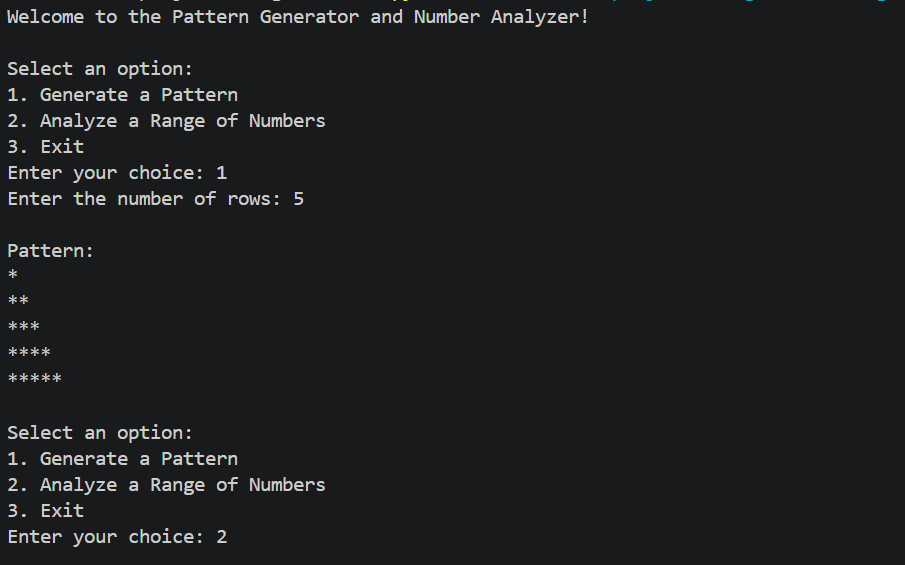
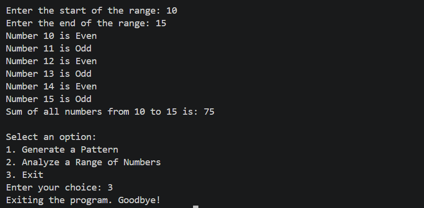

# Logic Box

## Project Description
Logic Box is a Python project that generates patterns and analyzes a range of numbers using loops and conditional statements.

## Features
- Right-angled triangle pattern generator
- Odd and even number checker
- Sum of numbers in a given range
- Menu-driven interface
- Input validation
- Uses for loops, while loops, nested loops, and match-case

## Output 

